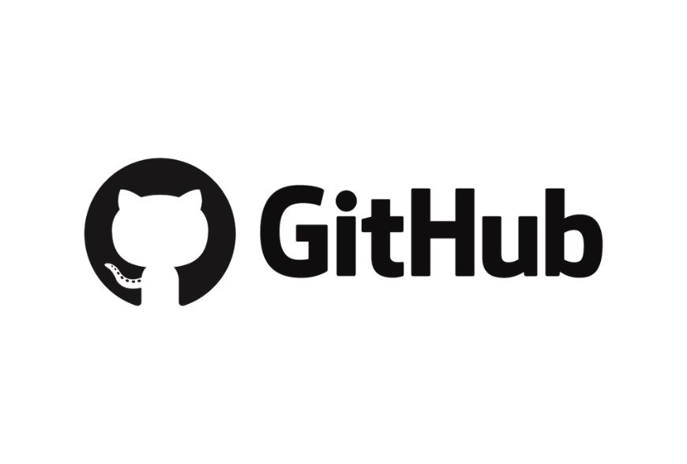
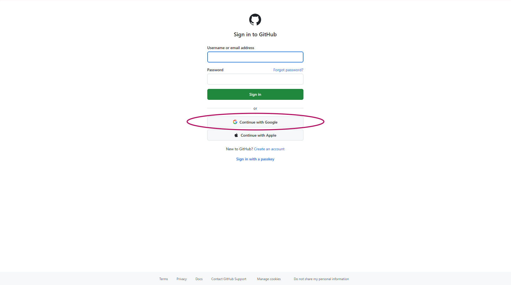
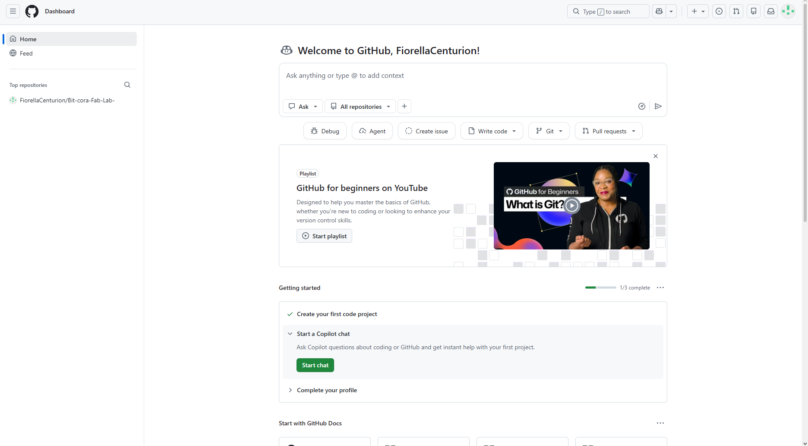

# GitHub y GitBook • Documentación

## <mark style="color:$info;">**¿Qué son GitHub y GitBook?**</mark>

Antes de contar cómo creé mis cuentas, quiero explicar qué es cada una de estas herramientas, porque al principio yo no tenía muy claro para qué servían.



<figure><figcaption></figcaption></figure>

<mark style="color:$info;">**GitHub**</mark> es una plataforma en internet donde se guardan archivos y proyectos, sobre todo de programación, pero también sirve para guardar documentación, imágenes o lo que uno necesite. Lo más útil es que lleva un historial de todos los cambios que hacés. Si algo sale mal, podés volver a una versión anterior y además, queda todo respaldado en la nube, así que no depende de que tu computadora siga funcionando.



<figure><figcaption></figcaption></figure>

<mark style="color:$info;">**GitBook**</mark> es una herramienta para crear documentación y publicarla online como si fuera una página web. Se escribe de forma bastante parecida a un documento de Word: agregás títulos, textos, imágenes, enlaces, y después lo compartís con un link. Es ideal para ir registrando procesos paso a paso y en mi caso lo voy a estar utilizando como el lugar en donde voy a ir escribiendo y mostrando mi documentación.



Lo bueno es que las dos se pueden conectar entre sí, así que lo que escribo en GitBook puede quedar guardado también en GitHub :)

***

## <mark style="color:$info;">**Creación de cuenta en GitHub**</mark>



### Registro en GitHub

<figure><figcaption>
Al ingresar a la página web y al registro, le di directo a iniciar con mi cuenta de Google.
</figcaption></figure>

Lo primero que realicé fue entrar al apartado de documentación que nos facilitaron las guías Ara y Vero en el grupo de Whatsapp, luego de eso entré a la página oficial de GitHub y me registré con lo que sería mi cuenta de Google para poder hacer el proceso mucho más rápido.



### Exploración

<figure><figcaption>
Captura del inicio de la plataforma de GitHub
</figcaption></figure>

Al registrarme todo, entré a lo que sería la página principal y realmente mi primera impresión fue que no entendía nada jaja, principalmente porque se encontraba en ingles, idioma que si bien manejo no tengo completo conocimiento y más al entrar a una página cuyo contenido se me dificultaba bastante de entender en cuanto a términos y forma de trabajo, fue una interfaz muy nueva para mí.



### Autenticación de cuenta

Una vez ya creada mi cuenta, lo que pasé a realizar después fue el enlazarlo o sincronizarlo a GitBook, para ello me pedía poder validar la cuenta descargando la app y agregando mi correo electrónico entre otras cosas, por lo que realicé cada uno de esos pasos.

<figure><figcaption>
Captura de la app de GitHub.
</figcaption></figure>

Al confirmar o autenticar lo que sería mi cuenta no pude utilizar la app para escritorio ya que pide una suscripción para la misma por lo que utilicé la plataforma en su versión web nada mas.



### Sincronización con GitBook

<figure><figcaption></figcaption></figure>

En este paso lo que quise hacer fue como sincronizar mi cuenta de GibHub con GitBook y si bien ya lo podía hacer me pedía como elaborar un repositorio lo que realmente no comprendí en primera instancia el como realizarlo o crearlo ya que es la primera vez que trabajo con una plataforma que involucra conocimientos básicos en informática, como con lo que sería la implementación de códigos entre otras cosas por lo que en este campo en específico lo terminé dejando así, sin sincronizar ya que no le comprendí demasiado.



***

## <mark style="color:$info;">**Creación de cuenta GitBook**</mark>



### Registro en GitBook

<figure><figcaption></figcaption></figure>

Lo primero que hice fue buscar GitBook en google y entrar al link de la página, una vez ahí acepté las cookies y me registré con mi cuenta de google.



### Exploración

<figure><figcaption></figcaption></figure>

Luego de registrarme me llevó directo a lo que sería la plataforma en sí en donde podía crear mi espacio de trabajo y empezar a realizar lo que sería mi página de documentación.

<figure><figcaption>
Creación de un espacio de prueba para la elaboración de la documentación 
</figcaption></figure>

Al principio lo que hice fue como usar una estructura de documentación ya hecha para poder empezar a realizar cambios desde la misma pero me encontré con el inconveniente de que no me dejaba hacer la edición de la misma, lo que me llevó MUUCHO tiempo corregir. Fui viendo en los ajustes, pero como en la interfaz está todo escrito en ingles se me dificultaba un poco sumado a eso que no estaba muy familiarizada con este programa al ser mi primera vez utilizandolo. Si bien en otras materias ya utilicé una plataforma llamada **Notion** (de la que voy a hablar un poco mas abajo) que es un poco similar a GitBook, esa plataforma es mucho más intuitiva y como más fácil de empezar con la creación de su contenido.

<figure><figcaption>
Referencia de como se ven las plantillas de documentación en GitBook
</figcaption></figure>

Luego de buscar y buscar, de probar de todas las formas posibles, la compañera Cielo me ayudó con la parte de desbloquear lo que sería la edición primeramente ayudandome a crear un nuevo espacio de trabajo para luego añadirle lo que sería una página en blanco y de ahí empezar a realizar mi bitácora sin la necesidad de una plantilla.

<figure><figcaption></figcaption></figure>

El error que encontramos dentro de todo esto fue que mi página ya se encontraba publicada por lo que no me dejaba editar en tiempo real, una vez solucionado eso ya pude empezar con la edición de la misma.



### Personalización de mi bitácora

Ya con todo listo para poder empezar a trabajar lo que hice primeramente fue delimitar los colores que quería utilizar para la parte estética de mi bitácora, así también como su estructura, el tamaño que iban a abarcar las imágenes dentro de la misma y la forma en la que iba a presentar la información o a redactar la misma, realicé los covers de las distintas páginas correspondientes tanto a cada módulo como también a cada programa trabajado y los fui colocando a medida que iba redactanto lo elaborado dentro de cada uno, los covers para las páginas los realicé tipo collage en la plataforma de Canva, ya que me resultaba mucho más fácil.

<figure><figcaption>
Elaboración de covers tipo collage en la plataforma de Canva 
</figcaption></figure>



