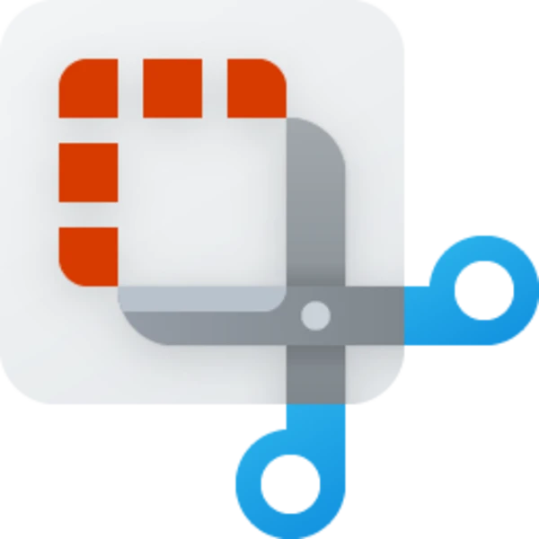
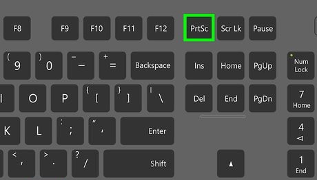

# Herramienta de Screenshot

## <mark style="color:$info;">**¿Qué es la herramienta Recortes de Windows?**</mark>

La herramienta Recortes de Windows es una aplicación integrada en el sistema operativo que permite realizar capturas de pantalla de forma rápida y sencilla. Con ella, es posible capturar toda la pantalla, una ventana específica o un área seleccionada, según lo que se necesite registrar.

Entre sus principales funciones se encuentran la captura de imágenes, el recorte de áreas específicas, la realización de anotaciones y, en las versiones compatibles, la grabación de pantalla en video.

<figure><figcaption></figcaption></figure>

Para utilizarla, se puede presionar la combinación de teclas **Windows + Shift + S**, seleccionar el tipo de captura y marcar el área deseada. Una vez realizada, la imagen se copia al portapapeles y se puede abrir para editarla o guardarla.

## <mark style="color:$info;">**Modo de uso**</mark>



### <mark style="color:$warning;">**Primer paso**</mark>

<figure><figcaption></figcaption></figure>

El primer paso es presionar el botón de Print Sc que se encuentra en la parte superior derecha de los teclados tanto en notebooks como en computadoras, en caso de que no contenga este botón también se puede utilizar el comando de **Windows + Shift + S.**



### <mark style="color:$warning;">**Segundo paso**</mark>

<figure><figcaption></figcaption></figure>

Una vez presionado el botón o el comando se te va a aparecer lo que sería una serie de opciones en la parte superior central de la pantalla con la que podrás elegir si es que lo que querés es una captura de pantalla o una grabación de video, asi también el área de la patalla que desees capturar ya sea de forma libre o por ventana o directamente de forma completa entre otras más opciones.



### <mark style="color:$warning;">**Tercer paso**</mark>

<figure><figcaption></figcaption></figure>

Luego de realizar la captura se te va a abrir la imagen capturada en la que vas a poder realizar ediciones como colocarle circulos, flechas, escribir encima de la misma, escanear el texto y muuuuuchas otras opciones más que tiene esta herramienta.

<figure><figcaption></figcaption></figure>

<figure><figcaption></figcaption></figure>

<figure><figcaption></figcaption></figure>

<figure><figcaption></figcaption></figure>

<figure><figcaption></figcaption></figure>

Una vez que hayas realizado todas las modificaciones que desees simplemente le das a guardar y listo, ya tienes tu captura o video editados en tiempo real super fácil y rápido! :)



