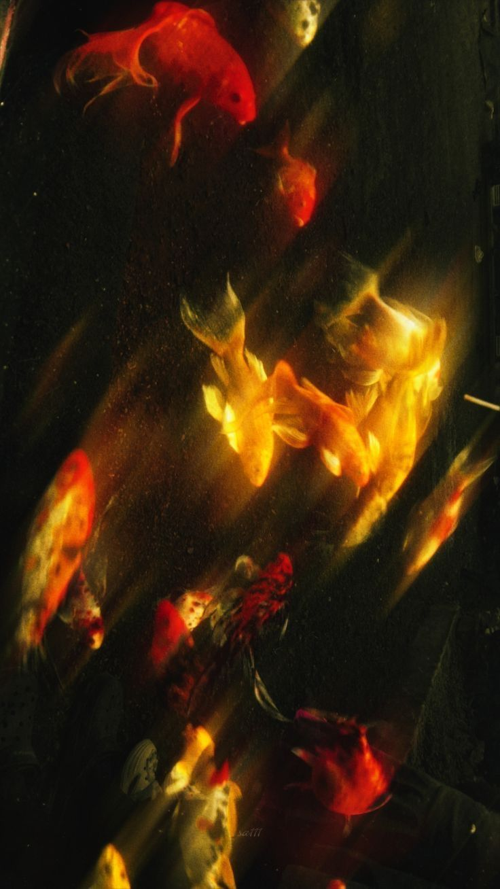
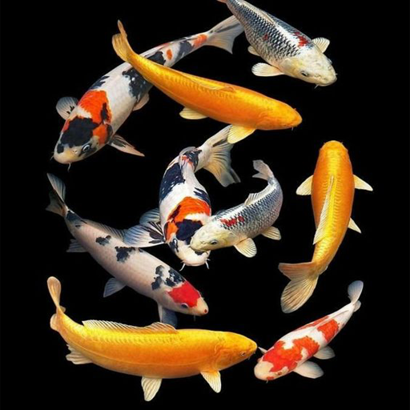
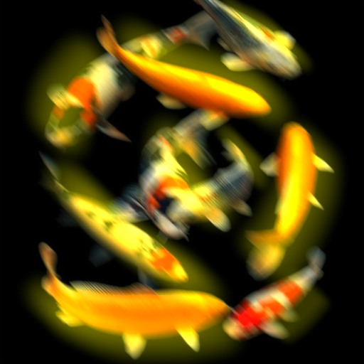

# Gimp | Editor de imágenes

## <mark style="color:$info;">**¿Qué es GIMP y para qué se utiliza?**</mark>

GIMP es un software gratuito de edición de imágenes que permite retocar fotografías, modificar colores, eliminar fondos y realizar composiciones gráficas. Cuenta con herramientas que facilitan la creación y edición de imágenes mediante capas, textos, filtros y otros recursos visuales.

<figure><figcaption></figcaption></figure>

Es una herramienta útil dentro del diseño gráfico, ya que permite trabajar con imágenes para distintos tipos de proyectos, como afiches, publicaciones para redes sociales, catálogos y materiales publicitarios. Además, al ser un programa de código abierto, se puede utilizar de forma gratuita.

## <mark style="color:$info;">**Exploración**</mark>



### <mark style="color:$warning;">**Instalación de la app**</mark>

Para comenzar, busqué GIMP en Google e ingresé al primer enlace que apareció entre los resultados.&#x20;

<figure><figcaption></figcaption></figure>

Desde allí, descargué la versión del programa compatible con Windows. Una vez finalizada la descarga, ejecuté el archivo como administrador y seguí los pasos correspondientes para completar la instalación.&#x20;

<figure><figcaption></figcaption></figure>

Finalmente, abrí el programa para comprobar que se hubiera instalado correctamente y poder comenzar a explorar sus herramientas.



### <mark style="color:$warning;">**Exploración**</mark>

Una vez el programa ya abierto, lo siguiente que hice fue revisar más o menos las herramientas que tenía.&#x20;

<figure><figcaption></figcaption></figure>

Realmente el programa en sí o la interfaz es bastante intuitiva, si es que ya estás familiarizado con algún otro programa de diseño. En mi caso estoy bastante familiarizada con los paquetes de Adobe, entonces tiene como una interfaz bastante similar, por lo que se me hizo como mucho más fácil el uso del programa y también el poder encontrar las herramientas necesarias para poder realizar la edición que tenía de tarea.



### <mark style="color:$warning;">**Uso del sofware**</mark>

Para poder empezar a utilizar el software, lo primero que hice fue buscar como una inspiración de la imagen que quería realizar o del trabajo que quería realizar. Una vez encontrada la imagen, busqué una imagen base para poder realizar como la inspiración que tenía en mente usando como base esa imagen. En este caso quise utilizar como imágenes así con un efecto, que serían como de unos pececitos. Entonces, al encontrar la inspiración busqué la imagen base de unos peces koi tratando de encontrar así una imagen en buena resolución y lo descargué.&#x20;

<figure><figcaption>
Inspo de lo que quería realizar
</figcaption></figure>

Posterior a eso subí esta imagen a lo que sería el programa. Algo que sí noté es que para subir los archivos, si bien es similar el programa a los paquetes de Adobe, a la hora de buscar el archivo para subirlo sí es más diferente. Se parece como mucho más a Blender en esa parte, por lo que sí creo que es un poquito más complicado el buscar y encontrar la imagen para poder subir al archivo para poder subir al programa. Y nada, una vez que subí la imagen al programa ya empecé a trabajar con el lienzo.

<figure><figcaption></figcaption></figure>



### <mark style="color:$warning;">**Proceso de Edición**</mark>

Ya con la imagen base, dentro de lo que es el programa, empecé a añadir capas. Lo primero que hice fue colocar como un fondo, una capa con relleno de un color un poco más oscuro que me pueda servir como un fondo para lo que sería la imagen final.&#x20;

<figure><figcaption></figcaption></figure>

Luego de eso, lo que hice fue colocarle una capa transparente por encima de la capa de la imagen base, en esa capa transparente lo que hice fue colocar como líneas en color amarillo utilizando la herramienta de pincel. Una vez que utilicé la herramienta de pincel, lo que hice fue irme a filtros y utilizar un difuminado de movimiento lineal ajustando y probando ahí los valorespara ver cuál me gustaba o me convencía un poco más y una vez hecho esto me fui a la parte donde están las capas y en la parte de modos fui probando los modos para ver cuál me gustaba más, cómo quedaba y luego le bajé un poquito la opacidad a esto para que no se note demasiado.&#x20;

Lo siguiente que hice fue trabajar con la capa base de los pececitos. Primero dupliqué la capa base que tenía y sobre esta capa duplicada fue que empecé a trabajar. Lo que hice fue también irme al filtro y colocarle un filtro así de movimiento para que tenga más o menos el mismo efecto que el brillo amarillo y por último hice una última capa más con relleno.&#x20;

<figure><figcaption></figcaption></figure>

Este relleno le puse un color así verdoso más o menos y lo que hice fue poner por encima de todas las capas y trabajar un poquito también con la parte de filtros y dándole como un efecto un poquito granulado para que después también en modo combinar esta capa y bajarle un poquito la opacidad y queda así un efecto más vintage, puede ser, logrando así más o menos, no del todo el efecto que quería según la inspiración que tenía.

<figure><figcaption></figcaption></figure>

Por último lo que hice fue guardar el archivo, tanto como el archivo de GIMP, como exportar la imagen que realicé en PNG. y ya estaba listo mi resultado.



### <mark style="color:$warning;">**Resultado finaaaaal c:**</mark>

<figure><figcaption>
Imagen base
</figcaption></figure>

<figure><figcaption>
Resultado Final
</figcaption></figure>

Bueno, el resultado final sería este. Realmente no me quedó así tal cual como la imagen de referencia o la inspiración que tenía, pero se acerca bastante y estoy como conforme con el resultado ahora, ya que es como mi primera vez utilizando el programa GIMP. Sí me gustó muchísimo, porque siento que si bien el tema de las herramientas o la colocación de los elementos dentro de lo que es la interfaz se parece muchísimo a Illustrator o Photoshop, considero con esta primera experiencia de uso que es mucho más fácil de utilizar, no se traba mucho también algo que es muy importante recalcar y que las vistas previas, por ejemplo, funcionan de maravilla, algo que suele fallar mucho en Illustrator, por lo que me encantó trabajar realmente con este programa y me gustaría como seguir explorando, hacer más diseño dentro del mismo en más oportunidades. y obviamente, en algún punto ser tan buena que a lo mejor volver a realizar este ejercicio de hacer esta imagen de inspiración, pero ya logrando como un resultado mucho más similar a mi referencia :))


