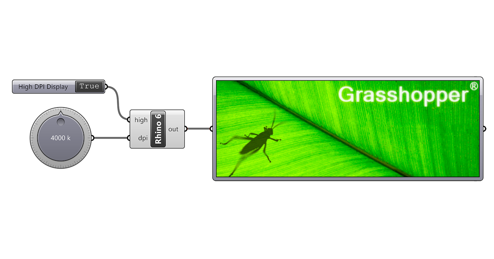

# Grasshopper

### <mark style="color:$info;">**¿Qué es Grasshopper de Rhino y para qué sirve?**</mark>

Grasshopper es una herramienta de programación visual que funciona dentro de Rhinoceros 3D (Rhino). Sirve para crear y modificar modelos 3D mediante conexiones entre bloques llamados componentes, sin tener que escribir código tradicional para empezar.

Se utiliza mucho en diseño industrial, arquitectura, diseño paramétrico y fabricación digital, porque permite generar formas complejas y cambiar un diseño rápidamente modificando algunos parámetros.

Por ejemplo, podés crear una superficie con perforaciones, una lámpara con piezas repetidas o un patrón geométrico para un objeto. En vez de modificar cada elemento manualmente, configurás las reglas y Grasshopper actualiza el modelo por vos.&#x20;

<figure><figcaption></figcaption></figure>

#### **¿Cómo funciona?**&#x20;

Grasshopper trabaja conectando componentes entre sí. Cada componente realiza una tarea y pasa sus resultados al siguiente. El modelo se actualiza a medida que cambiás los valores.

1. **Parámetros:** Son los valores que controlan el diseño, como la cantidad de elementos, el tamaño, la distancia entre piezas o el radio de una curva.
2. **Componentes:** Son los bloques que realizan operaciones, como crear puntos, dibujar líneas, generar superficies o repetir objetos.
3. **Conexiones y resultado:** Conectás los componentes mediante cables y ves el resultado en la ventana 3D de Rhino. Cuando estás conforme, podés usar Bake para convertir la geometría generada en objetos normales de Rhino.

### <mark style="color:$info;">**¿Cómo usamos grasshopper para crear un vector?**</mark>



### Elegir una imagen

Lo primero que debemos de hacer es buscar una imagen que nos guste y que deseemos vectorizar, en mi caso decidí buscar en Pinterest y fui descargando aquellas que consideraba que tenían luces y sombras más marcadas ya que esto es muy importante para la hora de vectorizar.



### Rhino y youtube :)

Lo siguiente que hacemos es ver un vídeo tutorial de cómo utilizar grasshopper más que nada porque el uso de este plugin de rhino lleva muchos pasos y también porque al menos en mi caso no estaba para nada familiarizada con el mismo por lo que era prácticamente nuevo para mí, para este paso el vídeo que me sirvió muchísimo y que seguí paso a paso es el siguiente:&#x20;


Video MEGA ÚTIL para este plugin


Algo también muy importante a saber es que a partir de la versión de Rhinoceros 8 este plugin ya viene instalado por lo que lo podemos encontrar en la parte superior de nuestra barra de herramientas una vez ya dentro de Rhino y le damos click al apartado de Estándar y allí vamos a encontrar un ícono de color verde circular con un saltamontes y listoo

<figure><figcaption></figcaption></figure>

Ya abierto el plugin lo que hacemos es subir la imagen que seleccionamos con los siguientes parámetros:

<figure><figcaption></figcaption></figure>

Entramos en params y le damos a **image sample**

<figure><figcaption></figcaption></figure>

Se nos va a desplegar esta ventana por lo que le damos a la parte de File path para cargar el archivo y luego seleccionamos en channel la opción de que nuestra imagen quede en blanco y negro para que el proceso de vectorización sea mucho más sencillo

<figure><figcaption></figcaption></figure>

Ya con nuestra imagen cargada en nuestro espacio de trabajo vamos siguiendo el tutorial de youtube paso a paso para poder llegar al resultado esperado

<figure><figcaption></figcaption></figure>

Una vez que terminamos de seguir los pasos del tutorial lo siguiente que hacemos es probar los valores en nuestra imagen de contraste y brillo para ir generando las circunferencias a nuestro gusto, yo fui probando con varias imágenes porque la que se puede visualizar allí me generaba demasiado circulos por lo que decidí optar por otra para que a la hora de realizar el dibujo no tarde demasiado.

Ya con el vector hecho y terminado lo último que queda hacer es exportarlo y guardarlo en formato dxf.



### De .dxf a .plt

Lo siguiente que hacemos es utilizar el programa de RdWorks para poder convertir nuestro archivo de rhino a un archivo compatible con la máquina de plóter, para esto lo que hacemos es abrir RdWorks e importamos nuestro archivo en dxf

<figure><figcaption></figcaption></figure>

Una vez con nuestro archivo abierto lo que hacemos es colocar el punto de origen en la esquina inferior izquierda y ajustar la escala del documento al tamaño que nos gustaría que tenga, ya con todo listo lo único que queda por hacer es exportar nuestro archivo y listo

<figure><figcaption></figcaption></figure>



### Dibujo con Vivi :)

Ya lo último que queda es pasar a dibujar con Vivi y para esto utilizamos nuevamente GCC file uploader y seguimos los mismos pasos que con los stickers multicapas para cortar pero esta vez lo que cambia es que vamos a dibujar, ¿y cómo vamos a hacer eso? vamos a sacar la cuchilla de corte de la máquina y vamos a colocarle un bolígrafo o pincel de punta prefentemente fina y con eso ya podemos empezar a dibujaaaar

<figure><figcaption></figcaption></figure>



### Resultado final !!!

<figure><figcaption></figcaption></figure>

El dibujo tomó en total: **15:05 min**

Si bien tuve algunos problemas al principio con las manchas del pincel, una vez solucionado llegué a un resultado bastante hermoso para mí y que me deja muy contenta c:











