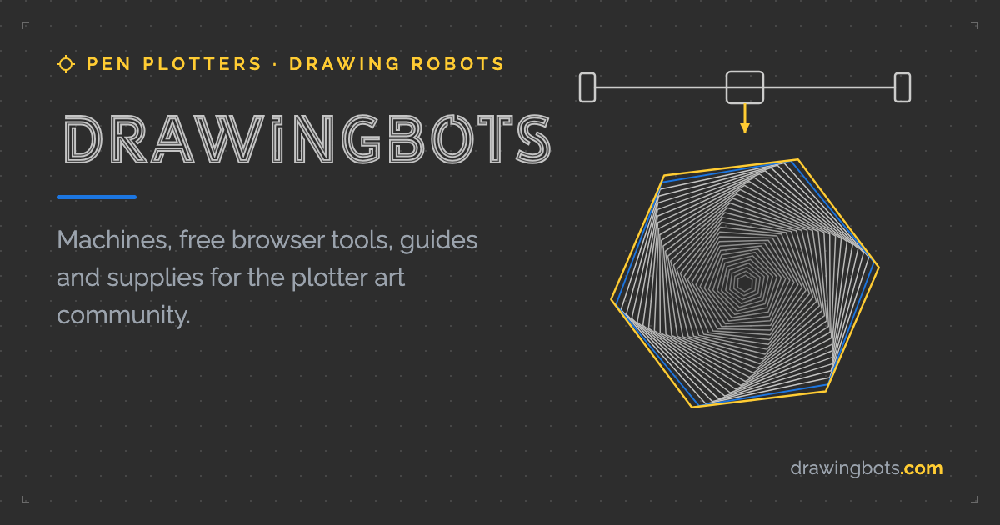

# Penploter art

### ¿Qué es el penploter art?

El Pen Plotter Art es una forma de arte que utiliza un plotter de pluma, una máquina que dibuja sobre papel siguiendo instrucciones digitales. Se caracteriza por crear ilustraciones a partir de líneas, formas geométricas y patrones, combinando la precisión de la máquina con el resultado físico del dibujo.

### DrawingBots Tools

<figure><figcaption></figcaption></figure>



DrawingBots Tools es una plataforma web que recopila herramientas, programas y recursos relacionados con el dibujo automatizado y el arte generativo. Está orientada a la creación de ilustraciones mediante algoritmos, líneas, formas geométricas y patrones, que pueden generarse a partir de imágenes o diseños propios.

#### ¿Para qué sirve?

Sirve para explorar diferentes métodos de creación gráfica y preparar diseños para dibujarlos mediante un plotter de pluma. Sus herramientas permiten transformar fotografías en ilustraciones lineales, generar patrones, experimentar con composiciones geométricas y crear dibujos con distintos estilos. También es útil para diseñadores que buscan combinar tecnología y creatividad, ya que algunas herramientas permiten exportar los resultados en formatos vectoriales como SVG para editarlos y adaptarlos a otros proyectos.

### <mark style="color:$info;">**¿Cómo usar DrawingBots?**</mark>



#### Exploración de la página web

Primero, ingresé a la página web de DrawingBots para explorar las diferentes herramientas que ofrece. Fui entrando en cada una para ver qué funciones tenía y qué tipo de resultados podía conseguir. A partir de esa exploración, elegí las tres herramientas que más me llamaron la atención para probarlas.

<figure><figcaption></figcaption></figure>



#### Prueba de las herramientas

Una vez que elegí las herramientas, empecé a probarlas con imágenes que ya tenía descargadas previamente para trabajar con Grasshopper, pero que finalmente no llegué a utilizar en ese programa. Aproveché esas mismas imágenes para experimentar con las opciones que ofrecía cada página web.

<figure><figcaption></figcaption></figure>

La verdad es que el proceso fue bastante sencillo, porque básicamente era ir jugando con los parámetros que te daba cada herramienta hasta conseguir un resultado o una forma que me gustara.

<figure><figcaption></figcaption></figure>



#### Exportación de los archivos

Cuando ya tenía un resultado que me gustaba, lo único que tenía que hacer era darle a la opción de exportar para descargar el archivo generado. En teoría, con eso ya tenía listo el diseño para pasar al siguiente paso, que era prepararlo para utilizarlo en la máquina de plotter.

<figure><figcaption></figcaption></figure>



#### Preparación del archivo en RDWorks

Después, pasé el archivo descargado a RDWorks para convertirlo al formato PLT, que es el que necesitaba para poder enviarlo posteriormente a la máquina. Sin embargo, me encontré con un problema al momento de exportar, porque el programa no me permitía hacerlo.

<figure><figcaption></figcaption></figure>

Por eso, volví a pedirle ayuda a una compañera para que me ayudara a realizar la conversión del archivo. Una vez solucionado ese inconveniente, ya pude continuar con el proceso sin problemas.



#### Ajuste del tamaño y prueba de dibujo

Al hacer la primera prueba con la máquina, me encontré con otro problema: el dibujo salió en un tamaño demasiado grande. Aunque ya había escalado el archivo antes de pasarlo al plotter, aparentemente todavía no estaba en las dimensiones que necesitaba.

<figure><figcaption></figcaption></figure>

Entonces, volví a corregir el tamaño del archivo y lo dejé aproximadamente en 15 × 15 cm. Después de realizar ese ajuste, ya pude hacer el dibujo correctamente, y el proceso tomó alrededor de 12 minutos.



#### Paso 6. Resultados y aspectos pendientes

<figure><figcaption></figcaption></figure>

Finalmente, pude realizar una de las pruebas que había preparado utilizando las herramientas de DrawingBots.net. No llegué a explorar los otros dibujos que tenía preparados debido al tiempo, pero tengo pensado retomarlos más adelante para seguir probando las posibilidades que ofrecen estas herramientas y ver qué otros resultados puedo conseguir con el plotter.


















