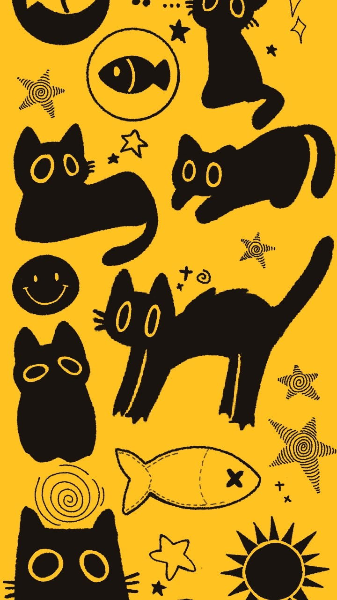

# Sticker multicapas

### <mark style="color:$info;">**¿Qué son los stickers multicapas y como realizarlos?**</mark>

Los stickers multicapas son diseños adhesivos compuestos por varias piezas de vinilo de diferentes colores que se superponen para formar una imagen completa. Para elaborarlos, primero se prepara y vectoriza el diseño en un programa como Adobe Illustrator, separando cada color en una capa independiente. Luego, cada pieza se corta por separado y se ensambla cuidadosamente para obtener el sticker final.

Para realizar este proceso, es necesario preparar el diseño en un formato vectorial que permita conservar sus líneas y contornos. En este caso, se utiliza el formato **DXF**, que permite guardar el diseño sin perder calidad y facilita su transferencia a programas compatibles con el corte. El archivo se prepara en Illustrator y luego se importa al software correspondiente para enviarlo a la **Vivi la rara (plotter de corte)**, que utiliza una cuchilla para reproducir las formas sobre el vinilo adhesivo.

Es importante verificar la compatibilidad del archivo con el software de envío antes de realizar el corte, además de comprobar las dimensiones y la separación de las piezas para facilitar el armado posterior.

### <mark style="color:$info;">**Pasos para realizar nuestro vector para el sticker multicapas**</mark>&#x20;



### Selección de la imagen

Lo primero que hay que hacer es buscar una imagen que tenga diferentes cólores y formas, idealmente con contornos más definidos y pocos colores para que a la hora de vectorizar la imagen nos sea mucho más fácil. En mi caso decidí buscar en pinterest dos imágenes de referencia de estilos que me gusten y descargarlas.

<figure><figcaption>
Búsqueda en Pinterest
</figcaption></figure> <figure><figcaption>
Imagen seleccionada
</figcaption></figure>




### Vectorización de la imagen

Lo que se debe de realizar posteriormente es importar la imagen descargada en el programa de tu preferencia pero que pueda exportar tu archivo en formato .dxf, en mi caso lo que hice fue utilizar illustrator ya que estoy familiarizada con el programa y porque me permite guardar en el formato que se necesita.

<figure><figcaption>
Preparación de archivo en Illustrator
</figcaption></figure> <figure><figcaption>
Importación de archivos para vectorización
</figcaption></figure>

Antes de realizar la importación lo que hice fue crear dos mesas de trabajo y ver entre los vinilos adhesivos los colores disponibles para poder realizar el corte, una vez tuve todo esto puse los colores en la parte superior de mi archivo para ver con cuales iba a trabajar una vez vectorizada mi imagen para que todo pueda combinar.



### Separación por colores

Para vectorizar la imagen lo que utilicé fue la herramienta de calco de imagen que aparece en la barra superior una vez que colocas o cliqueas el cursos sobre la imagen importada, al darle el calco me generó el vector en blanco y negro por lo que después de eso fui probando las opciones de vectorización que posee illustrator para ver en cual me daba la mayor cantidad de capas por color que pueda utilizar.

<figure><figcaption>
Calco de imagen
</figcaption></figure> <figure><figcaption>
Aquí seleccioné la vectorización en 3 colores
</figcaption></figure>

Una vez vectorizada la imagen, se separan las formas según los colores que tendrá el sticker, cada color representa una capa de vinilo diferente, por lo que es importante que las piezas estén bien definidas y que no queden elementos innecesarios, también lo que realicé en esta parte fue el limpiar los contornos del vector eliminando cualquier nodo innecesario que pudiera haber.

<figure><figcaption>
Limpieza de la imagen vectorizada
</figcaption></figure>

Para poder determinar el tamaño de cada sticker lo que hice fue colocar un cuadrado de 9cmX9cm e ir colocando dentro cada sticker de forma que puedan tener todos por lo menos la misma altura y que por ende luego me entren todos en una hoja de tamaño A4.

<figure><figcaption>
Delimiticación de tamaño de cada sticker
</figcaption></figure>

Ya con el tamaño elegido lo último que fui haciendo fue elegir el color para cada capa de mi sticker, tanto lo que sería la base como el cuerpo, los ojos, las estrellas y demás.

<figure><figcaption>
Elección de colores por capas
</figcaption></figure>



### Organización de las capas

Ya con cada capa hecha lo que fui haciendo fue ir poniendo y organizando cada capa en una mesa de trabajo diferente según el color de vinilo adhesivo en el que quería cortar para ir guardando cada mesa por separado.

<figure><figcaption></figcaption></figure>



### Guardado del archivo en formato DXF

Una vez finalizado el diseño, lo que hice fue guardar en formato .dxf,  ya que es compatible con un programa al que debemos de importar el archivo para luego guardarlo en formato .plt, para esto lo que hay que hacer es ir a la parte superior del programa Illustrator y darle clic en la parte de archivo y en la opción de exportar, darle a exportar como .dxf y listo, ya tenemos nuestro archivo en ese formato.

<figure><figcaption></figcaption></figure>



### De .dxf a .plt

Ya con el archivo dxf, abrimos el programa de RdWorks para poder preparar ahora si nuestro archivo final, al abrir el programa lo primero que hacemos es importar nuestro archivo en .dxf en el espacio de trabajo

<figure><figcaption>
Ícono para importar archivos, también se puede ir en el apartado de archivo y seleccionar importar
</figcaption></figure>

Ya con el archivo importado lo que hacemos es seleccionarlo para luego colocarlo en la esquina inferior izquierda, esto lo hacemos para que coincida con el punto de origen de la máquina de plóter de corte.

<figure><figcaption>
Con la ayuda de esa herramienta podemos colocar de forma mucho más fácil y rápida lo seleccionado en la esquina que lleguemos a necesitar. 
</figcaption></figure>

También algo muy importante que hay que hacer es asegurarnos de que el lugar de origen de nuestro archivo se encuentre en la esquina inferior izquierda, para ello hice una grabación de pantalla mostrando como modificar el lugar de origen y también como realizar la exportación en .plt



Ya con todos estos pasos hechos podemos pasar a la parte práctica y de corte con la máquina de plóter de corte c:



### <mark style="color:$info;">**Ahora sí, pasos para cortar nuestro sticker multicapas :)**</mark>&#x20;

### GCC FILE UPLOADER

Ya con nuestros archivos lo que hacemos es utilizar el programa de GCC uploader para poder subir nuestros archivos allí y pasarlos a la máquina de corte previamente prendida, en este programa lo único que hacemos es subir el archivo y cambiar en la parte de select a port a la opción de USB y listo&#x20;



### Espacio de trabajo

Lo primero que hacemos es prender la máquina de corte, pero antes de eso ya le colocamos lo que sería el soporte o área de trabajo en el cual va a ir nuestro vinilo para ser cortado y procedemos a calibrarlo y colocar un punto de origen o comienzo, una vez hecho esto lo conectamos a nuestra computadora o notebook para luego seguir con el siguiente paso:



### GCC FILE UPLOADER

Ya con nuestro espacio de trabajo listo lo que sigue es utilizar el programa de GCC uploader para poder subir nuestros archivos allí y pasarlos a la máquina de corte, en este programa lo único que hacemos es subir el archivo y cambiar en la parte de select a port a la opción de USB y listo ya tenemos nuestro archivo cargado para poder empezar por lo que le damos a **start**

<figure><figcaption>
Vista previa del programa GCC FILE UPLOADER
</figcaption></figure>



### Exploración ✖𐃷✖

Este paso es el más trabajoso ya que aquí empezamos a experimentar por primera vez el uso de la máquina de corte, en el cual tuve un proceso muy largo y tedioso para poder llegar al resultado final que vamos a ver muuuucho más adelante.&#x20;

<figure><figcaption>
Preparación del área de corte
</figcaption></figure> <figure><figcaption>
Primera prueba de corte
</figcaption></figure>

Las primeras exploraciones de corte no salieron muy bien que digamos ya que lo que yo en un principio realicé para poder "optimizar material" fue colocar todos los elementos que iban a ser cortados en color por ejemplo amarillo en un mismo espacio de trabajo por lo que el área de corte era mucho más grande y el soporte en el que debía de ir el vinil adhesivo no era completamente liso y por ende al ser tan grande el área a ser cortada no todas las partes se adherían bien al soporte o muchas veces el propio vinilo ya estaba arrugado o con burbujas que por más que intentaba aplanar lo más que se pueda no quedaba uniforme impedía que el corte pueda ser prolijo o bien la cuchilla arrastraba demás aquellas partes que se encontraban más por encima.

<figure><figcaption>
Pruebas, pruebas y más pruebas
</figcaption></figure>



### Corte y armado de capas

Una vez ya cortado por completo en la máquina todas las capas que necesitamos lo que procedemos a realizar es el armado de los stickers, para eso vamos organizando todas las capas que cortamos según lo que sería la base, el cuerpo y los detalles que van por encima.

<figure><figcaption>
Capas, capas y más capaaaas
</figcaption></figure>

Yo empecé cortando la base amarilla que tenía para ir colocándole por encima las demás capas, fui recortando los bordes ayudándome de un cúter o de una tijera dependiendo de lo que necesitara ya que en algunas partes la máquina no cortó lo suficientemente profundo para poder extraer por completo el material junto con su segurito de base.

<figure><figcaption>
Proceso de recorte
</figcaption></figure> <figure><figcaption>
Corte y armado de las capas
</figcaption></figure>

Ya cuando tenía todo preparado empecé con el armado de las capas, pegando con todo el cuidado del mundo una encima de otra evitando que hayan grumos o algún tipo de burbujita que pueda estar en el medio.



### Resultado finaaal ദ്ദി(｡•̀ ,<)\~✩‧₊

<figure><figcaption></figcaption></figure>

Y así fue como me quedaron mis stickers finalmente, al inicio tenia pensado colocarle sus ojitos en color blanco pero me gustaron más con el contraste en color amarillo, ya armados todos los stickers consideré que a pesar de las adversidades jaja vale muchísimo la pena realizar un trabajo de esta forma, la solución que encontré para poder evitar que los cortes se arrastren o no salgan finalmente fue imprimir uno a uno cada sticker por separado ya que de esa forma no le forzaba demasiado trabajar a Vivi, por lo que tuve un resultado dentro de lo que cabe bastante prolijo y satisfactorio c:



















