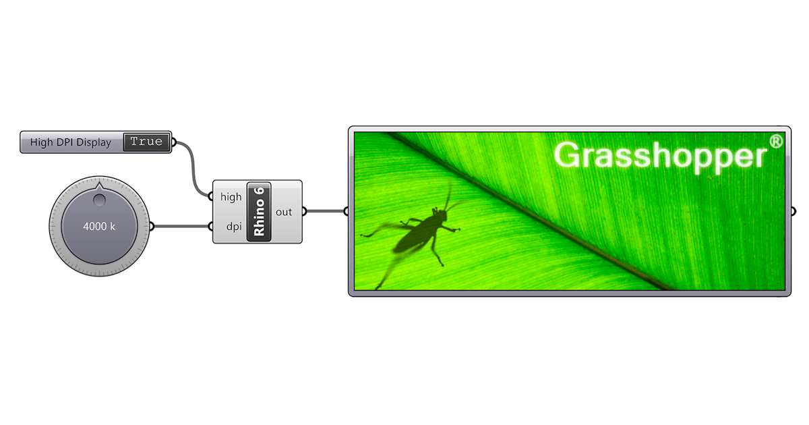

# Grasshopper

### <mark style="color:$info;">**¿Qué es Grasshopper?**</mark>

<figure><figcaption></figcaption></figure>

Grasshopper es una herramienta de programación visual que funciona dentro de Rhino y permite crear modelos 3D mediante componentes que se conectan entre sí. A través de estos componentes podemos modificar formas y dimensiones cambiando distintos parámetros, sin necesidad de modelar cada elemento manualmente.

### <mark style="color:$info;">**¿Cómo usamos grasshopper para crear una vasija?**</mark>



#### **Búsqueda de un tutorial de referencia**

Para comenzar con el ejercicio, primero busqué un video que me sirviera de guía para entender cómo crear una vasija desde cero en Grasshopper. A partir de este tutorial fui siguiendo los pasos, colocando los componentes y conectando los parámetros necesarios para generar la forma.





#### **Primer intento de modelado**

<figure><figcaption></figcaption></figure>

Siguiendo el tutorial, logré desarrollar una primera vasija utilizando varias circunferencias que se iban uniendo y modificando para formar el volumen. Sin embargo, al finalizar empecé a tener algunos problemas con las uniones de las superficies, ya que el modelo tenía muchas curvas y capas, lo que hizo que corregirlo fuera bastante complicado.

<figure><figcaption></figcaption></figure>

<figure><figcaption></figcaption></figure>


**Recomendación:** Algo que me pasó durante el primer modelado fue que Rhino se cerró inesperadamente mientras estaba trabajando en Grasshopper y no había guardado el archivo, por lo que perdí todo el avance y tuve que volver a realizar el modelo desde cero. Así que les recomiendo ir guardando sus archivos cada cierto tiempo para evitar perder todo el trabajo, especialmente cuando están trabajando con modelos que llevan varios componentes y conexiones.&#x20;




#### **Segundo intento: modelo más sencillo**



Como no estaba consiguiendo resolver esos problemas, decidí volver a empezar, pero esta vez buscando otro tutorial que me permitiera realizar una vasija más sencilla. A diferencia del primer modelo, que se generaba a partir de varias circunferencias, este segundo diseño partía de una curva de perfil que posteriormente se utilizaba para generar el volumen de la vasija.

<figure><figcaption></figcaption></figure>



#### **Modificación de parámetros**

Una vez que entendí mejor cómo funcionaba el procedimiento y cómo se conectaban los componentes, empecé a modificar los valores de los puntos de control de la curva, los radios y otros parámetros para ir cambiando la forma de la vasija hasta conseguir el resultado que quería.

<figure><figcaption></figcaption></figure>



#### **Corrección del modelo**

En el primer resultado que preparé para imprimir, había configurado un radio demasiado grande en la parte inferior de la vasija. Esto generó una pequeña concavidad o hueco en la base que, aunque no era tan evidente en el modelo, terminó ocasionando problemas durante la impresión, ya que esa zona no tenía suficiente material para sostener las capas superiores.

<figure><figcaption></figcaption></figure>

Por eso, volví a abrir el archivo en Rhino y Grasshopper para corregir la curva y ajustar la forma de la base. Fui probando diferentes valores hasta conseguir una forma que me gustara y que también pudiera imprimirse correctamente.



#### Exportación e impresión

Una vez finalizadas las modificaciones, guardé el modelo y lo exporté en formato STL para importarlo en Bambu Studio. Allí configuré los parámetros finales de impresión y preparé el archivo para enviarlo a la Bambu Lab A1.


**Algo que me quedó de este ejercicio:** al principio me enfoqué bastante en conseguir la forma que quería, pero después entendí que también era importante considerar cómo se iba a imprimir el modelo. No alcanza con que la vasija se vea bien en Rhino; también hay que revisar su geometría, las uniones y la base para evitar problemas durante la fabricación.




### <mark style="color:$primary;">**Resultado Final :)**</mark>

<figure><figcaption></figcaption></figure> <figure><figcaption></figcaption></figure>

<figure><figcaption></figcaption></figure>











