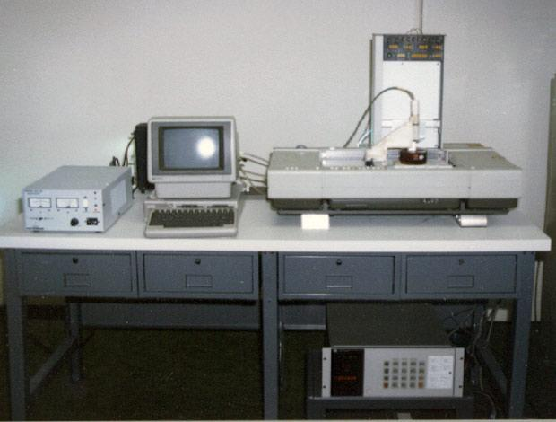
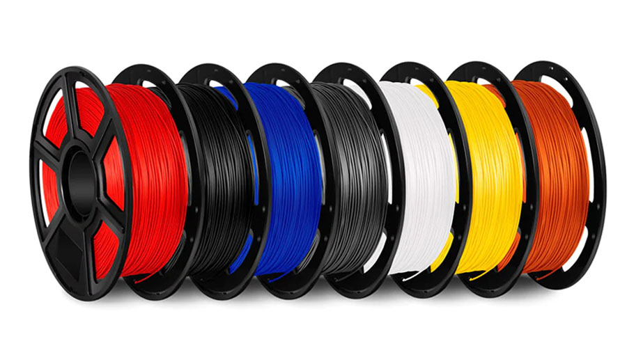
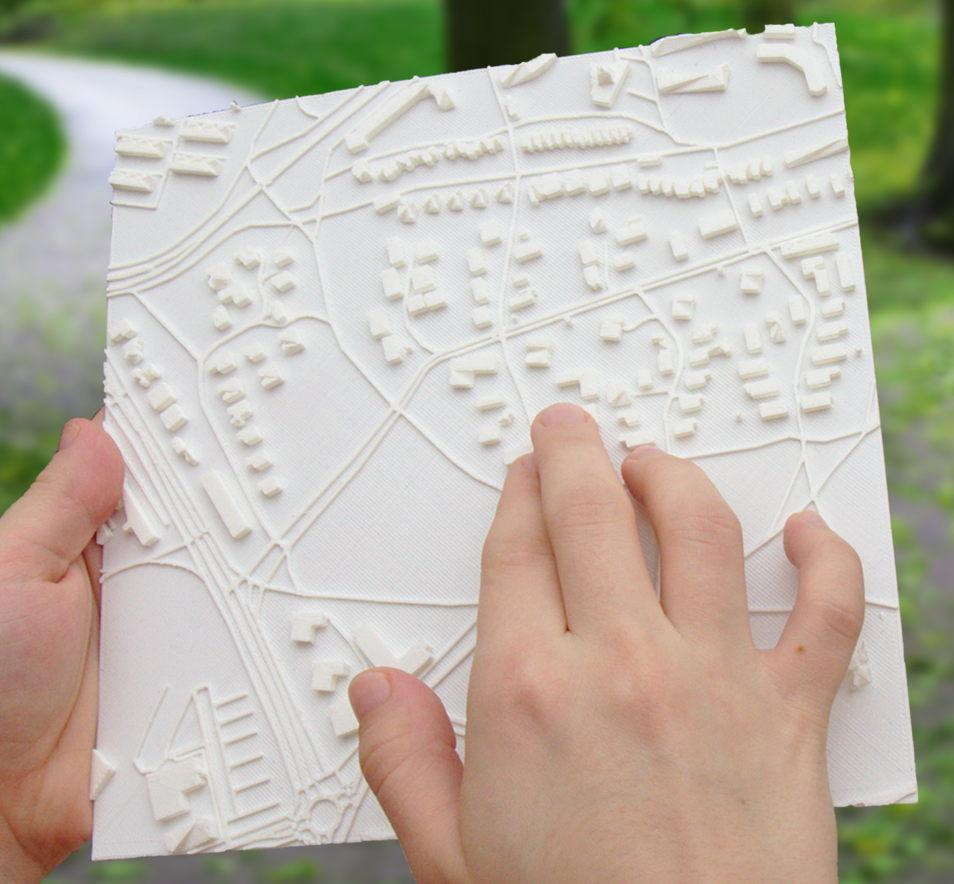
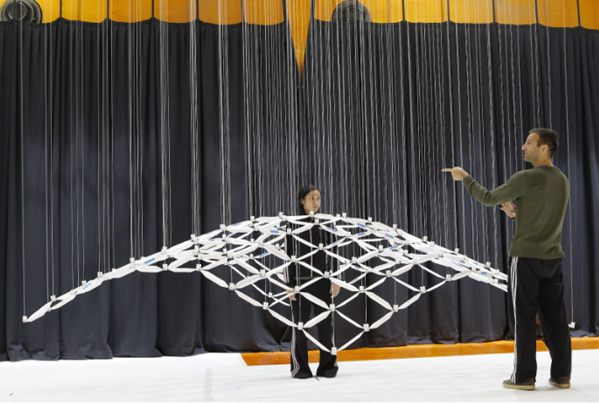

# Impresión 3D

## <mark style="color:$info;">**¿Qué es la impresión 3D?**</mark>

La impresión 3D, conocida formalmente como manufactura aditiva, es un proceso de fabricación mediante el cual se crean objetos tridimensionales a partir de un modelo o archivo digital. A diferencia de los métodos de fabricación tradicionales (como el mecanizado o fresado, que restan material), la manufactura aditiva construye las piezas depositando o solidificando material de forma sucesiva, capa por capa.

#### **¿Cómo nació la impresión 3D?**


{% column width="58.333333333333336%" %}
Todo comenzó a mediados de los años 80. En 1984, un inventor llamado Chuck Hull ideó una máquina que podía endurecer resina líquida usando luces ultravioleta, capa por capa. A este invento lo llamó Estereolitografía (SLA). Además, creó el formato de archivo STL, que hoy en día sigue siendo el lenguaje universal que entienden todas las impresoras 3D.


{% column width="41.666666666666664%" %}
<figure><figcaption></figcaption></figure>



Pocos años después, en 1989, Scott Crump inventó un sistema diferente: calentar un hilo de plástico (filamento) para ir construyendo figuras. Creó la empresa _Stratasys_ y patentó esta técnica conocida como Modelado por Deposición Fundida (FDM), que es el sistema más popular y común que vemos en la mayoría de las impresoras actuales.

Durante sus primeras dos décadas, las impresoras 3D eran aparatos gigantescos, industriales y carísimos que solo las grandes fábricas podían pagar. Todo cambió drásticamente en 2005 con el Proyecto RepRap, una iniciativa mundial de código abierto cuyo objetivo era crear impresoras capaces de imprimir piezas para construir otras impresoras. Esto rompió el monopolio industrial, abarató los costos de los componentes y permitió que cualquier persona pudiera tener una impresora 3D en su casa, escuela o taller.

### <mark style="color:$info;">**Filamentos utilizados en impresión 3D**</mark>&#x20;

En el FabLab trabajamos principalmente con cuatro tipos de filamentos: PLA, TPU, PETG y ABS. Cada uno tiene características diferentes, por lo que la elección depende del tipo de pieza que se quiera fabricar, su resistencia, flexibilidad y el uso que se le va a dar.

Los parámetros pueden variar según la marca del filamento, la impresora y las condiciones de impresión. Estos son rangos generales de referencia para trabajar con cada material.



#### **PLA (ácido poliláctico)**

<figure><figcaption></figcaption></figure>

Es uno de los materiales más utilizados en impresión 3D porque es fácil de imprimir y permite obtener piezas con buenos acabados. Se utiliza principalmente para prototipos, objetos decorativos y modelos que no necesitan soportar temperaturas elevadas.

**Parámetros de impresión:**

* Temperatura de boquilla: 190–220 °C.
* Temperatura de cama: 0–60 °C.
* Velocidad de impresión: 40–100 mm/s.
* Ventilador: 100 % después de las primeras capas.

**Fortalezas:**

* Es fácil de imprimir y no suele presentar muchas complicaciones.
* Tiene buena definición y acabado superficial.
* Presenta poca contracción durante el enfriamiento.
* Está disponible en una gran variedad de colores.

**Debilidades:**

* Tiene poca resistencia a temperaturas elevadas.
* Es menos flexible y puede quebrarse ante ciertos impactos.
* No es el más adecuado para piezas que estarán expuestas al sol o al calor durante mucho tiempo.



#### **TPU (poliuretano termoplástico)**

Es un material flexible y elástico que permite fabricar piezas que pueden doblarse, comprimirse y recuperar su forma. Se utiliza para crear objetos que necesitan cierta flexibilidad y absorción de impactos.

<figure><figcaption></figcaption></figure>

**Parámetros de impresión:**

* Temperatura de boquilla: 210–240 °C.
* Temperatura de cama: 30–60 °C.
* Velocidad de impresión: 20–40 mm/s.
* Ventilador: 50–100 %.

**Fortalezas:**

* Tiene buena flexibilidad y elasticidad.
* Resiste la abrasión y el desgaste.
* Puede absorber impactos y vibraciones.
* Es útil para fabricar piezas flexibles y personalizadas.

**Debilidades:**

* Su impresión puede ser más lenta que la de otros filamentos.
* Puede presentar dificultades de alimentación por su flexibilidad.
* Requiere ajustar la velocidad y la retracción para evitar problemas de impresión.



#### **PETG (tereftalato de polietileno glicol)**

Es un material que combina facilidad de impresión con una buena resistencia mecánica. Se utiliza para fabricar piezas funcionales que necesitan soportar golpes, humedad y un uso más frecuente.

<figure><figcaption></figcaption></figure>

**Parámetros de impresión:**

* Temperatura de boquilla: 220–250 °C.
* Temperatura de cama: 70–85 °C.
* Velocidad de impresión: 40–70 mm/s.
* Ventilador: 30–60 %.

**Fortalezas:**

* Tiene buena resistencia mecánica y a los impactos.
* Presenta mayor resistencia al calor que el PLA.
* Tiene buena resistencia a la humedad.
* Es adecuado para fabricar piezas funcionales y resistentes.

**Debilidades:**

* Puede generar hilos o filamentos finos entre las partes impresas (stringing).
* Puede adherirse demasiado a la superficie de impresión.
* Su acabado puede presentar más imperfecciones si los parámetros no están bien ajustados.



#### **ABS (acrilonitrilo butadieno estireno)**

Es un material resistente y duradero, utilizado principalmente para fabricar piezas funcionales que necesitan soportar impactos y temperaturas más elevadas. Sin embargo, requiere un mayor control de las condiciones de impresión.

<figure><figcaption></figcaption></figure>

**Parámetros de impresión:**

* Temperatura de boquilla: 230–260 °C.
* Temperatura de cama: 90–110 °C.
* Velocidad de impresión: 40–60 mm/s.
* Ventilador: 0–30 %.
* Se recomienda utilizar una impresora cerrada para mantener una temperatura estable.

**Fortalezas:**

* Tiene buena resistencia mecánica y a los impactos.
* Soporta temperaturas más elevadas que el PLA y el PETG.
* Es duradero y adecuado para piezas funcionales.
* Puede lijarse y trabajarse posteriormente.

**Debilidades:**

* Puede deformarse o despegarse de la cama durante la impresión (warping).
* Necesita una temperatura de impresión elevada.
* Puede liberar vapores y olores durante la impresión, por lo que requiere buena ventilación.
* Es más difícil de imprimir que el PLA.



<mark style="color:$success;"><strong>Otros tipos de filamentos utilizados en impresión 3D</strong></mark>

Además de PLA, TPU, PETG y ABS, existen otros filamentos que se pueden utilizar en impresión 3D FDM. Cada uno está pensado para aplicaciones y necesidades específicas.

**ASA (acrilonitrilo estireno acrilato):** Es similar al ABS, pero tiene mayor resistencia a la radiación UV y a las condiciones climáticas. Se utiliza para piezas que estarán expuestas al exterior.

**Nylon (poliamida):** Es un material resistente, flexible y duradero. Se utiliza para engranajes, bisagras, piezas mecánicas y componentes sometidos al desgaste. Es higroscópico, por lo que necesita mantenerse seco.

**PC (policarbonato):** Es un filamento con alta resistencia al impacto y a las temperaturas elevadas. Se utiliza para fabricar piezas técnicas y componentes que necesitan soportar condiciones exigentes.

**PVA (alcohol polivinílico):** Es un material soluble en agua que se utiliza principalmente como soporte para imprimir piezas con geometrías complejas. Después de la impresión, se disuelve en agua para retirarlo.

**HIPS (poliestireno de alto impacto):** Se utiliza tanto para fabricar piezas como para crear estructuras de soporte. Puede disolverse con determinados productos químicos, por lo que suele combinarse con ABS en impresiones de doble extrusor.

**Filamentos compuestos (madera, fibra de carbono y fibra de vidrio):** Son filamentos que combinan una base plástica con partículas o fibras de otros materiales. Permiten conseguir diferentes apariencias y propiedades, como texturas similares a la madera o mayor rigidez. Algunos son abrasivos y requieren boquillas resistentes al desgaste.

### <mark style="color:$info;">**Aplicaciones de la impresión 3D :)**</mark>

Buscando un poco más acerca de las aplicaciones de la impresión 3D, encontré que esta tecnología también tiene usos interesantes dentro del diseño gráfico. No se limita solamente a la creación de objetos o prototipos, sino que también permite experimentar con elementos visuales, recuperar piezas gráficas y llevar las ideas del plano digital a objetos físicos. Algunos ejemplos son:


{% column width="33.33333333333333%" %}
**Reconstrucción del patrimonio gráfico**

<figure><figcaption></figcaption></figure>


{% column width="66.66666666666667%" %}
La impresión 3D puede utilizarse para reproducir elementos gráficos antiguos que se encuentran deteriorados o que ya no se fabrican, como letras de carteles históricos, ornamentos tipográficos, símbolos y piezas de imprenta. A partir de fotografías, escaneos o modelos digitales, se pueden reconstruir estos elementos y crear réplicas físicas que ayuden a conservarlos, estudiarlos o exhibirlos. Es una forma de combinar tecnología y diseño para preservar parte de nuestra memoria visual y cultural.



***


{% column width="33.33333333333333%" %}
**Mapas táctiles**

<figure><figcaption></figcaption></figure>


{% column width="66.66666666666667%" %}
Mediante la impresión 3D se pueden crear mapas con relieves, texturas, símbolos y textos en braille que permiten representar espacios geográficos de manera táctil. Esto facilita que las personas con discapacidad visual puedan reconocer recorridos, ubicaciones y referencias espaciales a través del tacto. Es una aplicación donde el diseño gráfico se transforma en una herramienta de comunicación más inclusiva y accesible.



***


{% column width="33.33333333333333%" %}
**Experiencias visuales interactivas**

<figure><figcaption></figcaption></figure>


{% column width="66.66666666666667%" %}
La impresión 3D también permite fabricar piezas geométricas, estructuras y componentes que forman parte de instalaciones visuales interactivas. Estas pueden combinar movimiento, luz, sombras y formas para generar experiencias que cambian según la posición o interacción del espectador. Así, el diseño gráfico puede salir del formato tradicional y convertirse en una experiencia espacial donde el público también participa.



### <mark style="color:$info;">**Programas utilizados**</mark>

Durante este módulo utilizamos 3 programas y una plataforma de forma esencial para el desarrollo de las actividades pero eso no significa que sean los únicos que existen, en este ámbito hay una infinidad de programas que se pueden utilizar por lo que sería bueno explorar también los demás, pero por lo pronto te comento un poco más de los que en mi experiencia utilicé :)


{% column width="50%" %}
**Bambu Studio**




{% column width="50%" %}
Programa utilizado para preparar los modelos 3D antes de imprimirlos. Permite configurar parámetros como la altura de capa, velocidad, relleno y soportes, además de generar el archivo necesario para la impresora.



***


{% column width="50%" %}
**Meshmixer**




{% column width="50%" %}
Software que permite editar y modificar modelos 3D. Se utiliza para combinar piezas, agregar detalles, reparar modelos y prepararlos para la impresión.



***


{% column width="50%" %}
**Grasshopper**




{% column width="50%" %}
Herramienta de programación visual que funciona dentro de Rhino. Permite crear formas y modelos 3D mediante componentes conectados entre sí, modificando parámetros para generar diferentes resultados.



***


{% column width="50%" %}
**SelfCAD**




{% column width="50%" %}

Programa de modelado 3D que permite crear y editar objetos desde el navegador. Cuenta con herramientas para diseñar, esculpir y preparar modelos para su impresión.


