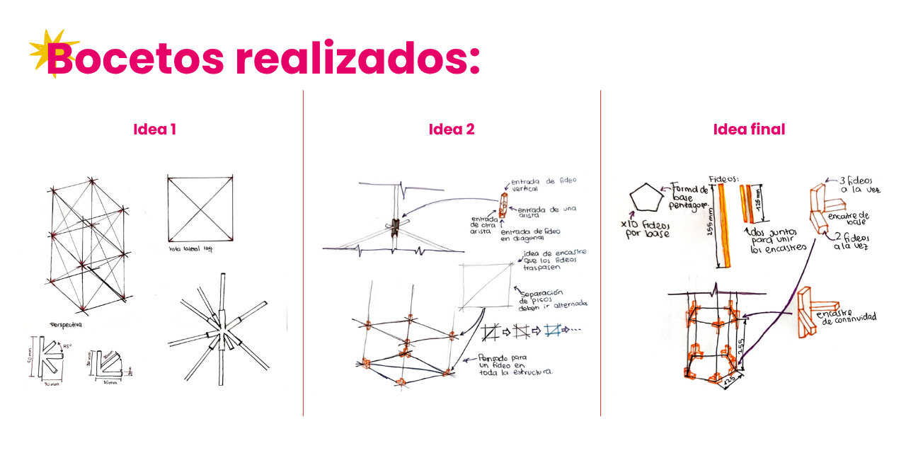
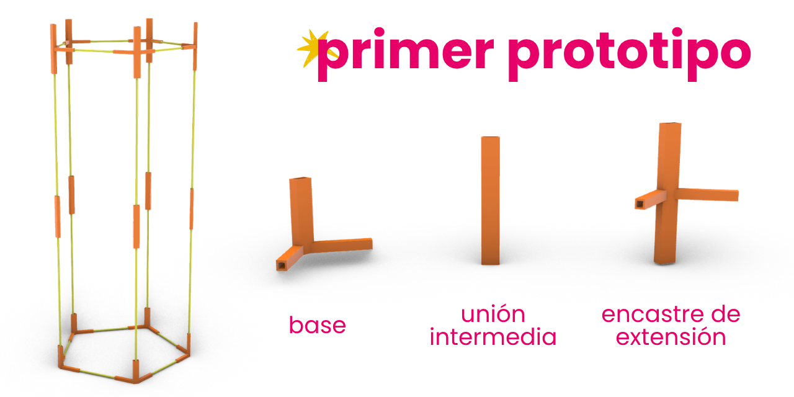
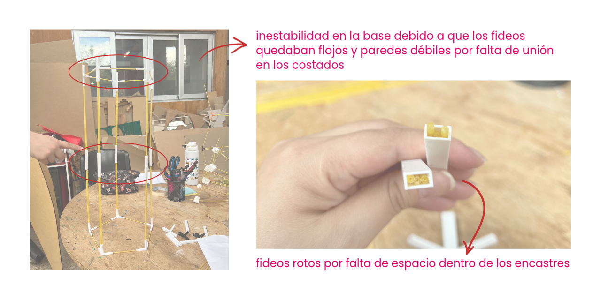
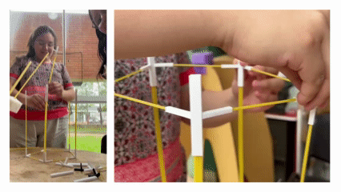
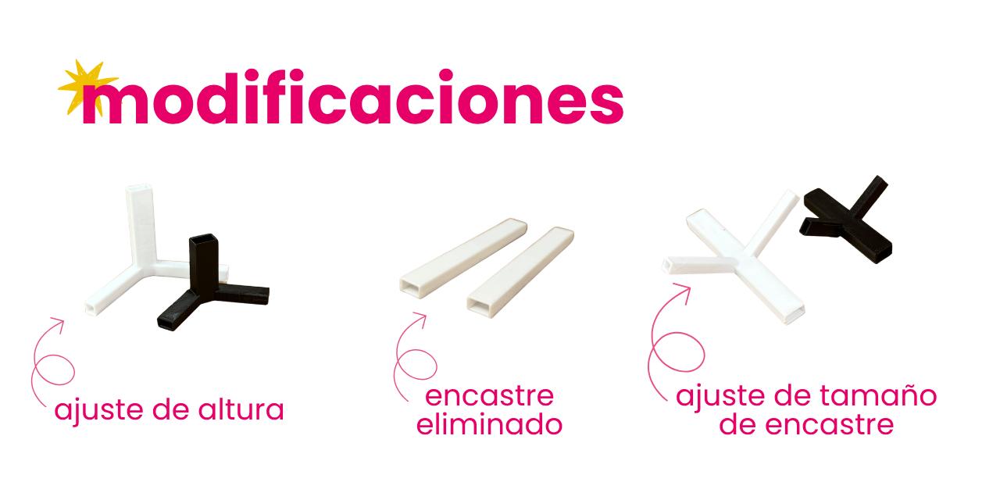
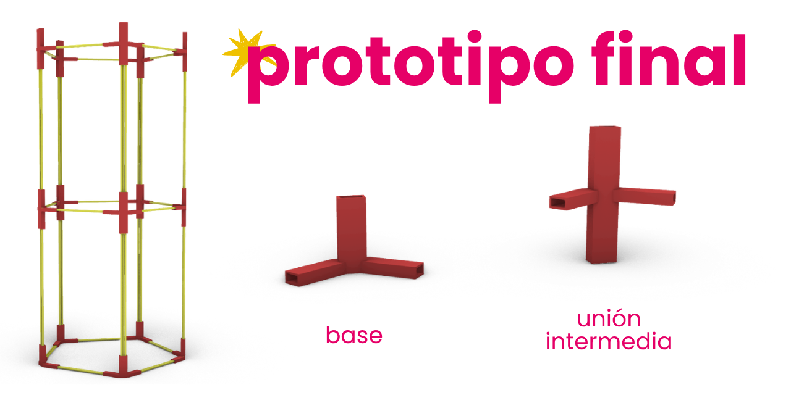
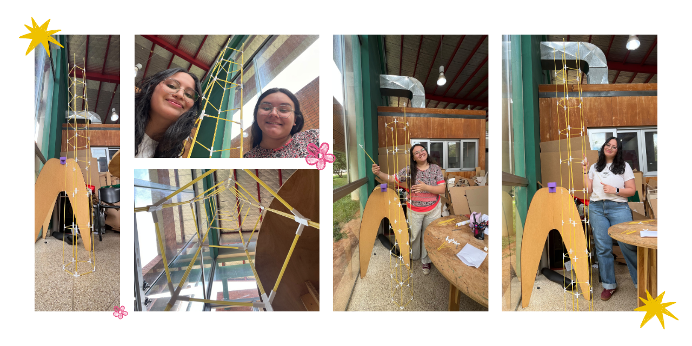

# La torre más alta de fideos

Para este desafío teníamos que diseñar y construir una torre utilizando fideos como elementos estructurales y conectores fabricados mediante impresión 3D. En principio, la actividad estaba pensada para realizarse de manera individual, pero debido al tiempo disponible terminamos trabajando en grupos de dos personas.

El objetivo era conseguir la mayor altura posible, manteniendo la estabilidad de la estructura y respetando las condiciones establecidas para el ejercicio.

**Material utilizado:** fideos Forattini.jpg>)

<mark style="color:$success;"><strong>Consideraciones del desafío</strong></mark>

**El objetivo será alcanzar la mayor altura posible manteniendo la estabilidad de la estructura.**

Diseñar y fabricar una estructura vertical utilizando fideos como elementos estructurales y conectores fabricados mediante impresión 3D FDM. La estructura deberá mantenerse estable por sí misma y alcanzar la mayor altura posible.

Proceso

1. Conocer el funcionamiento de la impresora 3D FDM.
2. Realizar test de impresión con diferentes parámetros.
3. Analizar el comportamiento del filamento.
4. Analizar diferentes sistemas de unión.
5. Diseñar un primer conector.
6. Imprimir el prototipo.
7. Probar el ajuste con los fideos.
8. Modificar el diseño considerando las tolerancias.
9. Imprimir los conectores definitivos.
10. Diseñar la estructura de la torre.
11. Construir la torre.
12. Realizar pruebas de estabilidad.
13. Realizar modificaciones.
14. Realizar la prueba final.

**REGLAS PRINCIPALES.**

1. Sin pegamento.
2. Sin cinta.
3. Sin tornillos.

### <mark style="color:$info;">**Proceso de diseño y bocetado**</mark>

Lo primero que hicimos fue tomar las medidas de los fideos para tener una referencia más precisa al momento de diseñar la estructura. Inicialmente pensamos que tenían un diámetro de 3 mm, pero después de medirlos mejor nos dimos cuenta de que era un poco menor, aproximadamente entre 2,5 y 2,7 mm. En cuanto al largo, cada fideo medía aproximadamente 25,5 cm.

<figure><figcaption></figcaption></figure>

<figure><figcaption></figcaption></figure>

#### <mark style="color:$info;">**Primer boceto**</mark>

Una vez que tuvimos las medidas, comenzamos con el bocetado. Nuestra primera idea fue realizar una estructura modular de cuatro lados, utilizando una base cuadrada y conectores impresos en 3D que permitieran encastrar los fideos en cada uno de los vértices. La idea era ir repitiendo este módulo hacia arriba para conseguir altura.

<figure><figcaption></figcaption></figure>

También pensamos en incorporar dos diagonales por cada lado, con una inclinación de 45°, que se conectarían con los encastres de la parte superior para reforzar la estructura y darle mayor estabilidad.

Al comenzar a probar cómo funcionaría esta estructura en la práctica, nos encontramos con un problema: al colocar los fideos con una inclinación de 45°, estos no alcanzaban a llegar hasta el siguiente encastre de la esquina. Esto hacía que tuviéramos que cortar los fideos para poder unirlos correctamente.

<figure><figcaption></figcaption></figure>

Sin embargo, nos dimos cuenta de que esta solución implicaría desperdiciar bastante material y, sobre todo, perder altura, que era justamente lo que buscábamos conseguir con el desafío. Por eso decidimos descartar esta primera propuesta y continuar explorando otras alternativas de diseño que nos permitieran aprovechar mejor el largo de los fideos.

#### <mark style="color:$info;">**Segundo boceto**</mark>

Para el segundo boceto decidimos mantener la idea de una estructura modular, utilizando nuevamente una base cuadrada. La diferencia era que, en cada nivel, queríamos incorporar un fideo que atravesara el centro del cuadrado de forma horizontal. La intención de este diseño era reforzar cada piso y lograr que la estructura tuviera una mayor estabilidad a medida que fuéramos agregando los módulos.

<figure><figcaption></figcaption></figure>

También contemplamos la posibilidad de utilizar un solo fideo por cada lado de la estructura, sujetándolo mediante los encastres impresos en 3D. Sin embargo, nos dimos cuenta de que esto podía hacer que la base fuera bastante débil. Por eso, pensamos en modificar los encastres para que tuvieran aberturas que permitieran atravesar la pieza con los fideos en distintas direcciones, tanto horizontal como verticalmente, logrando una unión más firme entre cada lado del cuadrado.

<figure><figcaption></figcaption></figure>

A pesar de esto, volvimos a encontrarnos con el inconveniente de la inclinación de la estructura, ya que al incorporar los fideos en diagonal se reducía la longitud disponible para alcanzar una mayor altura. Además, consideramos que fabricar estos encastres con tantas aberturas y direcciones podía complicar bastante el proceso. Por estos motivos, decidimos descartar también esta propuesta y continuar probando otras alternativas mediante nuevos bocetos.

#### <mark style="color:$primary;">**Tercer boceto y último boceto :)**</mark>

Finalmente, llegamos al tercer y último boceto, que fue el diseño que decidimos llevar a la etapa de prototipado e impresión 3D. Para esta propuesta optamos por cambiar la forma de la base y utilizar un pentágono. También decidimos trabajar con la mitad del largo de los fideos, utilizando piezas de aproximadamente 12,5 cm para formar cada lado. Tomamos esta decisión porque consideramos que, si utilizábamos los fideos en su largo completo, la torre podía perder estabilidad. Al reducir su longitud, buscábamos conseguir una estructura más firme y, al mismo tiempo, aprovechar mejor el material para poder alcanzar una mayor altura.

<figure><figcaption></figcaption></figure>

En esta propuesta también decidimos incorporar más fideos a la estructura para reforzarla. Como primera idea, planteamos utilizar un fideo para las partes horizontales y dos fideos para las partes verticales. A partir de esto, diseñamos nuestro primer modelo de encastre para imprimir en 3D.

**Primer prototipo**

Para este primer intento, diseñamos los encastres teniendo en cuenta la cantidad de fideos que queríamos utilizar en cada parte. Sin embargo, al momento de imprimir y probar las piezas, nos encontramos con un problema en las medidas. Inicialmente habíamos calculado que los fideos tenían aproximadamente 3 mm de diámetro, pero al medirlos nuevamente comprobamos que eran un poco más delgados.

<figure><figcaption></figcaption></figure>

Esto hizo que los encastres no se ajustaran como esperábamos. En las aberturas destinadas a las partes verticales llegaban a entrar hasta tres fideos, en lugar de dos. Por otro lado, en las aberturas de la base entraba solamente un fideo, pero quedaba demasiado espacio libre alrededor, haciendo que la unión no fuera firme y que la estructura tuviera cierta inestabilidad.

También buscamos reducir el consumo de filamento al momento de imprimir los encastres. Para eso, planteamos una primera unión más sencilla, formada por una pieza rectangular dividida en dos espacios, donde se podían colocar los fideos correspondientes a dos niveles de la estructura. La idea era utilizar este tipo de unión en las primeras partes de la torre y agregar, en los siguientes encastres, las uniones necesarias para conectar los vértices y reforzar cada nivel.

<figure><figcaption></figcaption></figure>

Sin embargo, al probar el armado nos dimos cuenta de que esta solución no funcionaba como esperábamos. Las paredes quedaban demasiado largas sin una unión intermedia que conectara los fideos entre sí, lo que generaba más inestabilidad. A esto se sumaba el problema de la base, que tampoco quedaba bien ajustada debido al espacio sobrante en las aberturas.

<figure><figcaption></figcaption></figure>

Otro aspecto que tuvimos que corregir fue la altura de los encastres. En un principio, diseñamos las aberturas con una longitud de 3 cm para que los fideos tuvieran una mayor superficie de contacto y pudieran sujetarse mejor. Pero, al realizar la primera impresión, notamos que esta medida era excesiva, ya que aumentaba el consumo de filamento sin aportar una mejora necesaria. Por eso, decidimos reducir la altura de estas piezas.

**Segundo prototipo y ajustes**

A partir de los errores del primer prototipo, realizamos algunas modificaciones en el diseño. Como comprobamos que en las aberturas verticales entraban hasta tres fideos y que esto podía aportar mayor estabilidad, decidimos mantener esa medida. En cambio, modificamos las aberturas de la base para que pudieran sujetar dos fideos, eliminando así el espacio sobrante que habíamos tenido en el primer intento.

<figure><figcaption></figcaption></figure>

También mantuvimos la reducción de altura de los encastres para evitar utilizar más filamento del necesario. Con estos cambios, realizamos una segunda impresión y volvimos a probar el armado de la estructura.

<figure><figcaption></figcaption></figure>

Esta vez comprobamos que las piezas encastraban mucho mejor y que la torre tenía una estabilidad considerablemente mayor. Por eso, decidimos imprimir más encastres y continuar armando la estructura para comprobar hasta qué altura podíamos llegar. A continuación, podemos ver parte del proceso de impresión, armado y prueba de nuestra torre.

### <mark style="color:$info;">**Resultado final**</mark>

Luego de las siguientes modificaciones entre el primer y segundo prototipo del último boceto, procedimos al armado de la torre.

<figure><figcaption></figcaption></figure>

Esta torre resultó estable, encontramos que la clave era la utilización de más de un fideo para la estructura, además de su base pentagonal que facilita que al exitir más caras esta estructura se hacia más difícil de tambalear o caer, sin dejar de prestar atención a los encastres que deben sujetar bien a cada fideo o de otra forma aunque tengamos una figura para una estructura estable igualmente esta puede caer.

<figure><figcaption></figcaption></figure>


**Documentación de sof** 𐔌՞ ܸ.ˬ.ܸ՞𐦯









