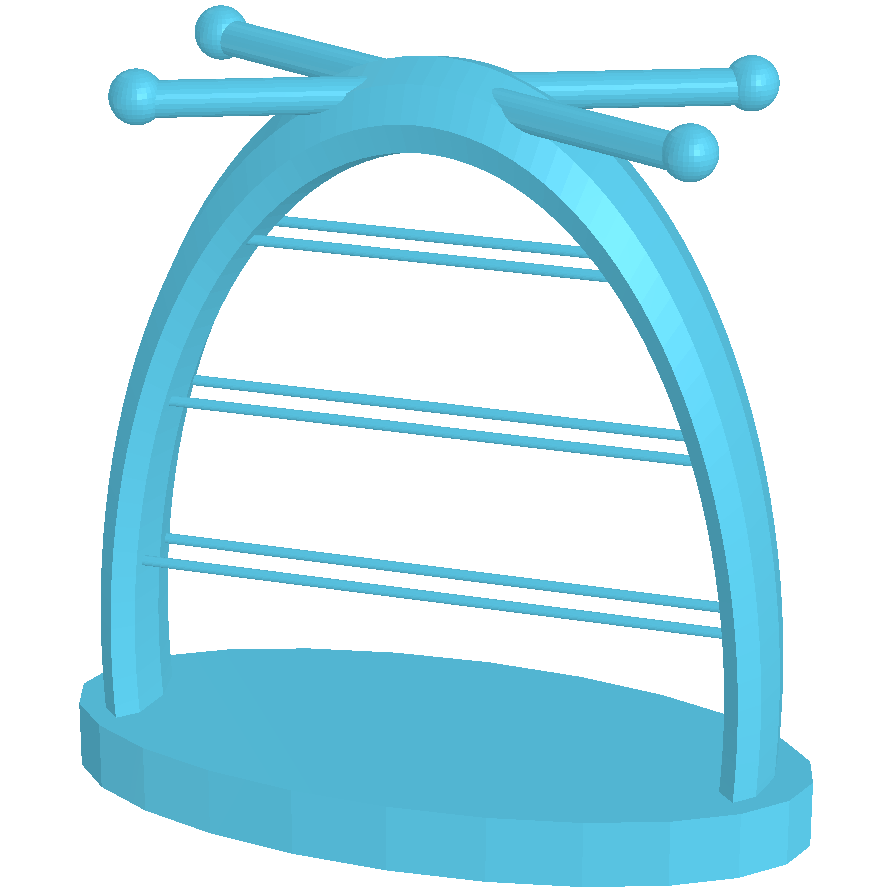

# SelfCAD

### <mark style="color:$info;">**¿Qué es, para qué sirve y cómo se utiliza?**</mark>

SelfCAD es una herramienta de diseño 3D que funciona directamente desde el navegador. Ofrece diferentes herramientas para crear objetos desde cero, modificar formas, agregar detalles, esculpir y preparar modelos para impresión 3D.

<figure><figcaption></figcaption></figure>

Su funcionamiento es bastante intuitivo, ya que cuenta con herramientas de modelado y edición que permiten trabajar directamente sobre el objeto. Una vez terminado el diseño, se puede exportar en diferentes formatos, como STL, para llevarlo a un programa de laminado como Bambu Studio.

### <mark style="color:$primary;">**Pasos para modelar en SelfCAD**</mark>



#### **Ingreso y registro en la plataforma**



<figure><figcaption></figcaption></figure>

Primero ingresamos a la página oficial de SelfCAD, creamos una cuenta y nos registramos para poder acceder a la plataforma.



#### **Exploración de la interfaz**

Una vez dentro, comenzamos a explorar la interfaz para conocer las herramientas disponibles, las opciones de modelado y cuáles de sus funciones podemos utilizar de forma gratuita.

<figure><figcaption></figcaption></figure>



#### **Búsqueda de una referencia**

<figure><figcaption></figcaption></figure>

En mi caso, inicialmente quería realizar una especie de joyero con forma de pote de helado, pensado para guardar aritos, cadenas y otros accesorios pequeños. Para esto busqué algunas referencias en Pinterest y encontré un diseño de cerámica que me gustó bastante. La idea era tomar esa referencia y adaptarla para poder modelarla en SelfCAD.



#### **Primer intento de modelado**

A partir de la referencia, empecé a experimentar con las herramientas que ofrecía la plataforma para conseguir una forma similar. Este primer intento también me sirvió para familiarizarme con las opciones de modelado, las modificaciones de volumen y las posibilidades que tenía el programa.

<figure><figcaption></figcaption></figure>

Sin embargo, cuando exporté el modelo y lo llevé a Bambu Studio, me di cuenta de que el tiempo estimado de impresión era de aproximadamente 12 horas, por lo que decidí buscar una alternativa más sencilla.

<figure><figcaption></figcaption></figure> <figure><figcaption></figcaption></figure>




#### Modificación y nuevos intentos

Decidí mantener la idea original de crear un joyero, pero simplificando bastante su forma y reduciendo sus dimensiones. Fui probando diferentes modelados, aproximadamente cuatro versiones, y cada vez los exportaba a Bambu Studio para comprobar cuánto tiempo llevaría imprimirlos.

<figure><figcaption></figcaption></figure>

Después de varios intentos, finalmente encontré un diseño que me convenció, tanto por su apariencia como por el tiempo de impresión, así que decidí quedarme con esa versión.

<figure><figcaption></figcaption></figure>



#### **Exportación del modelo**

Una vez terminado el diseño, lo exporté en formato STL y lo importé en Bambu Studio para revisar sus dimensiones, configurar los parámetros de impresión y comprobar que estuviera listo para fabricarse.



### <mark style="color:$info;">**Resultado final finalísimo**</mark>&#x20;

<figure><figcaption></figcaption></figure> <figure><figcaption></figcaption></figure>

<figure><figcaption></figcaption></figure>

<figure><figcaption></figcaption></figure> <figure><figcaption></figcaption></figure>

> **Mi experiencia utilizando SelfCAD**
>
> La verdad es que me gustó bastante trabajar con esta plataforma. Si bien considero que algunas de sus herramientas son un poco limitadas en comparación con otros programas de modelado 3D, me parecieron bastante intuitivas y fáciles de utilizar.
>
> Algo que me llamó mucho la atención es que se puede trabajar directamente desde el navegador, sin necesidad de descargar ni instalar un programa pesado. Esto facilita bastante el acceso, especialmente para quienes no cuentan con una computadora con la capacidad suficiente para ejecutar otros programas de modelado 3D.
>
> Además, ofrece diferentes formatos de exportación, lo que permite llevar los modelos a otros programas y continuar trabajando con ellos. En general, me pareció una herramienta bastante práctica para experimentar, aprender y desarrollar modelos 3D de una manera más sencilla.
>
>
















